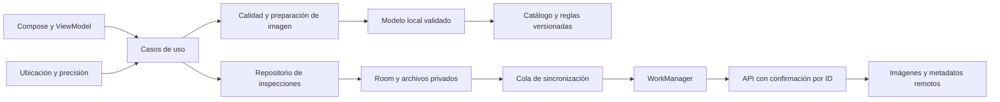

# Auditoría y transición de AgroVision a limón sutil en Sullana

Fecha de corte: 11 de octubre de 2026, America/Lima. Rama inspeccionada: `limon-change`. Último commit observado: `3f5a620`. La revisión incluye el estado de trabajo con cambios locales y archivos sin seguimiento; no se limita a ese commit.

## 1 Dictamen ejecutivo

**La arquitectura Android es aprovechable para una aplicación de apoyo a la identificación de plagas foliares del limón sutil. La solución actual no demuestra diagnóstico real, sincronización con Azure ni identificación temprana en campo.** La transición visible corresponde principalmente a nombres de pantalla; el contrato de inferencia, las reglas agronómicas y la persistencia conservan el dominio anterior.

Conviene continuar con Kotlin, Compose, CameraX, Room e inferencia local, corrigiendo la separación de responsabilidades y la trazabilidad. No se justifica reescribir toda la aplicación ni ampliar ahora a una plataforma multicultivo. Sí se requiere construir y validar un conjunto de datos de limón sutil, seleccionar plagas observables, entrenar un modelo apropiado y alinear los requisitos académicos con su salida real.

La referencia académica más reciente examinada, **recuento de t1- capstone.docx**, establece como título: «Implementación de una aplicación móvil para la identificación temprana de plagas en el cultivo de limón sutil en la Cooperativa Agraria LIMONORT-PERU, Sullana – 2026». Este informe adopta ese enfoque como destino solicitado por el usuario. No acredita aprobación institucional, existencia del padrón ni autorizaciones de campo.

La aplicación analiza fotografías de hojas; no cuenta frutos, estima rendimiento ni localiza limones como objetos. “Detectar limones” debe entenderse aquí como trabajar sobre el cultivo y sus plagas foliares. Un detector de frutos sería otro objetivo, otro dataset y otra validación.

## 2 Alcance y método de revisión

Se inspeccionaron los archivos de implementación de `app/src/main`, configuración Gradle y manifiesto; interfaces, entidades y consultas; generador SQL; las dos bases SQLite del repositorio; la memoria `database/PROYECTO_RECUENTO_SPRINT1_Y_DECISIONES_SPRINT2.md`; los ocho Word de la carpeta Documentos, las dos hojas del cronograma Excel y la imagen Ishikawa. Se extrajo texto de párrafos y tablas de los Word para comparación de contenido. No se evaluó su paginación ni se modificaron sus originales.

Carpeta académica verificada: `C:/Users/josem/OneDrive - Universidad Privada del Norte/UPN CICLO 2026-2/CAPSTONE PROJECT/Documentos`.

El cronograma Excel se leyó después de que el usuario cerrara el archivo que bloqueaba el acceso. Se revisaron fechas, duraciones, predecesoras, estados y etiquetas de ruta crítica de ambas hojas; no se encontraron fórmulas. La propuesta de reprogramación distingue hitos originales de fechas nuevas condicionadas a recursos y acceso de campo. La lectura no acredita cumplimiento de los hitos marcados como aprobados ni que las fechas sigan siendo las oficiales del curso.

La auditoría es estática con comprobaciones de integridad SQLite y contraste bibliográfico. No se ejecutó compilación, APK, pruebas de dispositivo, inferencia, mediciones de memoria ni llamadas al servicio Azure. La presencia de archivos de compilación antiguos no prueba que el estado actual compile o cumpla los requisitos.

Clasificación de evidencia: **implementado** significa código observable; **parcial** significa flujo incompleto; **simulado** significa salida generada sin el servicio o modelo prometido; **no encontrado** se refiere al alcance inspeccionado; **validado** se reserva para una prueba ejecutada con resultado documentado. No se asignan porcentajes de avance sin denominador y criterios de aceptación.

## 3 Comparación con la memoria de Sprint 1 y decisiones de Sprint 2

| Afirmación de la memoria | Evidencia actual | Corrección o implicación |
|---|---|---|
| Clean Architecture y MVVM con dominio independiente de Android | Hay capas, interfaces y casos de uso; el dominio no importa SDK Android. Los ViewModel construyen el clasificador y acceden directamente al DAO | MVVM reconocible y separación parcial. El repositorio no concentra los flujos reales |
| Inferencia TFLite al 75 por ciento | No se encontró `.tflite`, etiquetas, pesos, entrenamiento ni dataset en los archivos del proyecto inspeccionados | Adaptador de inferencia preparado; capacidad diagnóstica real no demostrada |
| Fallback determinista | Una imagen existente y no vacía, con intérprete ausente, devuelve clase 1, “Trips tabaci”, confianza 0.88 tras `delay(1200)` | Es un resultado fijo independiente de la fotografía; no es clasificación ni benchmark del modelo |
| Modelo MobileNetV2 INT8 | Es un texto de Ajustes y un nombre de archivo; la entrada usa floats y la salida está fijada a tres floats | Arquitectura y cuantización del modelo no verificables sin artefacto y metadatos |
| Motor de recomendaciones completo y basado en severidad | El caso de uso solo recibe `classId` y `confidence`; contiene `Allium cepa` y recomendaciones de riego de cebolla | Reglas implementadas, pero sin fenología, severidad agronómica ni validación para cítricos |
| Persistencia documental y móvil completamente alineadas | Room usa una entidad; el archivo documental tiene ocho tablas de aplicación y una vista, además de `sqlite_sequence` | Existe una tabla espejo `inspections`, pero no sincronización entre ella y `inspecciones_campo` |
| GPS parcialmente desarrollado | Coordenadas de parcelas son texto semilla. La entidad móvil no tiene latitud ni longitud; faltan permiso y proveedor de ubicación | No hay georreferenciación real por inspección |
| Cámara con retículo elíptico de limón | El código actual muestra un rectángulo 220 por 300 dp con esquinas de 32 dp | Guía visual reutilizable; no segmenta ni recorta automáticamente la hoja |
| Historial y resultados completos y persistencia garantizada | El guardado es manual; los resultados previos al guardado viven en una caché global | Recuperación desde Room solo para registros ya guardados; no garantía integral de cero pérdida |
| Sincronización Azure inicial | Worker marca registros como sincronizados sin HTTP; el botón espera 800 ms y hace lo mismo | Simulación que produce estado de respaldo falso. No se encontró encolado WorkManager ni cliente Retrofit configurado |
| Configuración diagnostica conectividad | Ajustes espera 1000 ms y devuelve siempre un mensaje local; Dashboard muestra Offline por lógica visual | No representa estado de red ni salud del backend |
| Baja memoria y ausencia de OOM | Captura a archivo, submuestreo, reciclado y mutex presentes | Buenas medidas; no hay perfil de memoria que pruebe los límites afirmados |
| Latencias inferiores a 300 ms | Ajustes dice aproximadamente 120 ms; fallback espera 1200 ms | Separar objetivo, estimación visual y resultado medido. No hay latencia de inferencia real |
| Compatibilidad con más del 95 por ciento de dispositivos de campo | `minSdk=24`, `targetSdk=34`; no inventario de smartphones | El porcentaje requiere evidencia local. El SRS fija Android 10/API 29 como mínimo objetivo |

Las decisiones de Sprint 2 siguen siendo pertinentes, pero deben corregirse: el dominio de destino ya se ha solicitado; la incorporación del modelo requiere contrato tensorial y dataset nuevos; la nube requiere reconocimiento individual del servidor; GPS no puede darse por iniciado; y el pre-poblado exige esquema Room compatible. El plan de tres semanas de la memoria no contempla adecuadamente acceso de campo, anotación, entrenamiento y evaluación académica.

## 4 Hallazgos técnicos prioritarios

Las rutas siguientes son relativas a `E:/TESIS/AGROVISION-LURIN-1/app/src/main/java/pe/edu/upn/agrovisionlurin` salvo indicación distinta.

| ID | Prioridad | Hallazgo y evidencia | Acción y aceptación |
|---|---|---|---|
| H01 | Crítica | `data/local/ml/TFLiteLeafClassifier.kt:29,82` carga un modelo de cebolla ausente y emite un diagnóstico fijo sin advertencia visible | Modo demo explícito y excluido de resultados de investigación; en producción, modelo ausente o inválido produce error recuperable |
| H02 | Crítica | `data/remote/AzureWorker.kt:26` y `presentation/history/HistoryViewModel.kt:83` actualizan sync sin envío | Solo IDs confirmados por servidor pueden quedar sincronizados; interrupciones y errores mantienen pendientes |
| H03 | Alta | `presentation/result/ResultViewModel.kt:31` acepta cualquier caché sin comparar `inspectionId` con `resultId` | Abrir registro A tras analizar B debe mostrar A; guardado debe pertenecer al registro visible |
| H04 | Alta | `data/local/ml/TFLiteLeafClassifier.kt:140` convierte confianza en severidad, incluso para clase sana | Confianza, severidad e incertidumbre deben ser campos distintos; severidad no evaluada hasta disponer de protocolo de daño |
| H05 | Alta | `TFLiteLeafClassifier.kt:69` devuelve “Cultivo Sano” para archivo ausente/vacío. Si decodificación devuelve null con intérprete cargado, el buffer no se rellena | Rechazar imagen inválida; no reutilizar valores de una captura anterior; probar archivo corrupto y resolución extrema |
| H06 | Alta | Entrada fija `[1,224,224,3]` FLOAT32 normalizada 0 a 1; salida `[1,3]`; sin inspección de tensores | Verificar dimensiones, dtype, normalización, etiquetas, cuantización y salida al cargar cada modelo |
| H07 | Alta | `domain/usecase/GetRecommendationsUseCase.kt:30` y `ResultViewModel.kt:82` conservan cebolla y Lurín | Catálogo versionado de cítricos; lote elegido persistido mediante ID real; eliminar recomendaciones incompatibles |
| H08 | Alta | `ResultCache` es un singleton de un único resultado; no se persiste antes de navegar | Crear borrador durable identificado antes de mostrar resultado; recuperar tras cierre del proceso; evitar cruce entre sesiones |
| H09 | Alta | `AppDatabase.kt:8` tiene versión 1 y `exportSchema=false`; el script elimina y regenera archivos existentes | Migraciones versionadas y prueba de conservación de historia; separar generación de datos demo de migración productiva |
| H10 | Alta | Login usa credenciales demo en código y sesión booleana en SharedPreferences | Autenticación y autorización reales o declarar acceso demo; especificar enrolamiento y desbloqueo offline según SRS |
| H11 | Alta | No hay filtro de desenfoque, validación de tejido/cultivo, cajas, multi-etiqueta ni métricas de ML | Resolver alcance clasificación frente a detección; calidad de captura y rechazo de imágenes fuera de dominio |
| H12 | Media | Historial filtra IDs 0,1,2; nombres repetidos en resultados, dashboard e historial | Catálogo de clases por versión y filtros derivados de categorías; impedir reinterpretación de registros históricos |
| H13 | Media | Repositorio guarda solo títulos y devuelve recomendaciones vacías; ResultViewModel guarda objetos JSON y después recalcula reglas | Un formato serializable y repositorio efectivo; conservar la recomendación original y su versión |
| H14 | Media | Copia de galería se hace en callback de UI; estado de análisis no tiene manejo integral de error con finally | Mover I/O a hilo adecuado; cancelar, informar errores y habilitar reintento sin quedar bloqueado |
| H15 | Media | Ajustes muestra parcela, modelo y tiempos fijos; “Iluminación Óptima” es texto sin medición | Mostrar configuración y disponibilidad verificadas; convertir el texto de luz en instrucción si no existe medición |

Otros endurecimientos: liberar descriptores y canales tras mapear modelo; prever cierre del intérprete; cubrir orientaciones EXIF reflejadas, no solo rotaciones; controlar archivos huérfanos tras repetir captura; evitar cargar todo el historial para cada contador y añadir paginación cuando el volumen lo requiera. Son mejoras específicas, no evidencia de fallo observado en un dispositivo.

## 5 Evaluación de arquitectura y viabilidad para limón sutil

### 5.1 Componentes reutilizables

Compose y navegación sirven para el mismo flujo de inspección. CameraX y almacenamiento privado son independientes del cultivo. El mutex y el procesamiento fuera del hilo de UI son apropiados para inferencia móvil. Room, DAO reactivo y UUID son una base útil para operación sin conexión. Las interfaces `LeafClassifier` e `InspectionRepository` permiten sustituir implementaciones sin cambiar todo el producto.

La arquitectura de destino debe hacer que ViewModel invoque casos de uso y repositorios inyectados. Un punto de composición sencillo es suficiente; introducir un framework de inyección es opcional. Separar ImageStore, ModelRunner, CatalogRepository, InspectionRepository, LocationProvider y SyncRepository mejora pruebas y evita que una pantalla decida sobre almacenamiento o transporte.

### 5.2 Modelo y tarea visual

MobileNetV2 puede usarse como base de transferencia para **clasificación** de fotografías de hojas, pero no convierte automáticamente pesos de cebolla en un modelo de cítricos. En este repositorio ni siquiera existen pesos que puedan evaluarse. El cambio de hoja tubular a lámina más ancha, textura, daño, iluminación y fondo exige datos y evaluación del dominio nuevo. El trabajo de Mohanty et al. (2016) muestra la dificultad de transferir resultados de imágenes controladas a contextos reales [B6].

La salida actual es una única clase por fotografía. Para conservar RF04 con delimitación de lesiones o insectos se requiere detector con cajas y puntuaciones, o segmentación si se medirá área dañada. Un backbone MobileNet puede integrar un detector; la implementación actual es solo un clasificador. No debe describirse “YOLO/MobileNet” como un único algoritmo intercambiable sin especificar cabeza, tarea y contrato.

Recomendación para alcance mínimo: clasificación asistida de hojas de limón sutil para un catálogo pequeño de plagas **confirmadas y observables**. Si la delimitación es indispensable en el SRS aprobado, debe mantenerse y presupuestarse el detector. La simplificación de RF04 necesita una nueva línea base, no una declaración de cumplimiento.

Una misma hoja puede presentar múltiples daños. Si el protocolo admite coocurrencia, usar salida multietiqueta o detección; si se mantiene clasificación exclusiva, documentar qué muestras mixtas se rechazan y los límites resultantes. Un argmax no cumple diagnóstico dual del RNF02.

### 5.3 Agricultura y catálogo

Usar de forma uniforme **limón sutil**, `Citrus aurantiifolia` como convención científica del expediente, **Cooperativa Agraria LIMONORT-PERU** y **Sullana, Piura, Perú**. Verificar la denominación botánica con el asesor agronómico y conservarla en el diccionario; no usar indistintamente “lemon”, limón amarillo y limón sutil al buscar datos.

El minador de los cítricos, `Phyllocnistis citrella`, es un candidato técnicamente razonable por las galerías observables en hojas jóvenes [B4]. Esto no acredita su presencia ni prevalencia en las parcelas de LIMONORT. Pulgones u otras plagas requieren confirmación local y protocolo de foto adecuado. El ácaro de la yema no debe incorporarse como clase de hoja RGB ordinaria solo porque aparece en la memoria de Sprint 2: tejido y escala de observación deben corresponder al organismo.

Una galería foliar puede indicar daño previo sin infestación activa. Registrar si la etiqueta corresponde a organismo presente, daño compatible o confirmación técnica. Color amarillento o deformación por sí solos no identifican inequívocamente una plaga. Usar negativos con daño mecánico, deficiencias y otros factores evita un dataset artificialmente fácil.

“Hoja sin síntomas visibles” es más defendible que “cultivo sano”: una imagen no demuestra sanidad de toda la parcela. “No concluyente”, “imagen inadecuada” y “fuera del dominio” deben ser estados operativos; no necesariamente clases entrenadas. Una puntuación softmax no debe presentarse como probabilidad clínica calibrada sin evaluación.

El recuento T1 elimina déficit hídrico del título y de Y. Se recomienda retirarlo del alcance principal y dejarlo como trabajo futuro, salvo justificación expresa de su reincorporación. RGB foliar aislado no sustenta por sí solo déficit hídrico ni una prescripción de riego; para estudiarlo se necesitarían referencias fisiológicas o de humedad, condiciones de muestreo y validación específica. La revisión multiespectral/térmica citada en el informe anterior no valida automáticamente una cámara RGB [B9].

Las recomendaciones deben ser apoyo a revisión y manejo validado por agrónomo, asociado a cultivo, plaga, tejido, fenología y versión de regla. No trasladar profundidad radicular de cebolla, trampas o ventanas horarias como receta universal de cítricos. No automatizar aplicaciones a partir de la confianza del clasificador. Los umbrales de intervención agronómica y los umbrales de decisión del modelo son distintos.

### 5.4 Contrato de inferencia

Incluir modelo, etiquetas y manifiesto con versión, SHA-256, cultivo, tejidos admitidos, forma y tipo de tensores, orden RGB, resize/crop, normalización, cuantización, significado de salida y umbrales validados. El nombre `quant_int8` no determina el tipo de entrada: existen modelos con operaciones cuantizadas y entrada/salida flotante [B1].

Si I/O es INT8, adaptar bytes y parámetros: `q = round(x/scale) + zeroPoint`, con recorte al rango permitido; salida real `x = scale*(q-zeroPoint)`. Leer dtype y parámetros desde el modelo. El buffer de 602112 bytes corresponde a FLOAT32; el equivalente de entrada INT8 de 224 por 224 por 3 sería 150528 bytes. Ninguna cifra representa memoria total del modelo o de la app.

La normalización actual 0 a 1 debe coincidir con el entrenamiento. MobileNetV2 de Keras usa habitualmente preprocesamiento de -1 a 1 [B2]; si el grafo incluye su propia normalización, aplicarla otra vez sería incorrecto. Validar paridad entre pipeline de entrenamiento y Android con fotografías de referencia y tolerancias registradas.

La guía visual no garantiza ROI. Elegir encuadre de hoja completa, crop central o detección de hoja, y aplicar el mismo criterio en entrenamiento y app. Mantener relación de aspecto cuando proceda; evaluar si 224 píxeles conserva síntomas incipientes. Fotografías de sensor de 8 MP no garantizan que un daño pequeño sobreviva al resize.

### 5.5 Datos, persistencia y sincronización

Las dos SQLite físicas pasan `integrity_check` y no presentan errores de FK en la comprobación realizada. Cada una contiene 3 usuarios, 3 parcelas, 3 diagnósticos, 8 recomendaciones, 5 registros en `inspecciones_campo`, 5 en `inspections` y 2 logs de sincronización. Son semillas creadas por script; ni los diagnósticos ni los HTTP 200 sembrados acreditan pruebas reales.

Las parcelas de muestra incluyen ají/paprika, fresa y palto/cítricos de Lurín: ni siquiera representan un catálogo exclusivamente de cebolla. GPS corresponde a parcelas semilla, no a captura del teléfono. La tabla Room no tiene FK a ese catálogo. La app crea su propia base interna `agrovision_database` y no abre automáticamente el archivo raíz `agrovision_database.sqlite`.

Hay una tabla espejo con columnas Room, pero la SQLite preparada no demuestra todos los índices y metadatos esperados. `createFromAsset` verifica esquema [B3]; no basta copiar el dump, ni existe propagación entre las dos tablas de inspección. Elegir Room como fuente local de verdad y generar semillas mediante inserciones controladas o una base verificada contra el esquema exportado.

Modelo mínimo propuesto: Organization, Plot, CropProfile, PestCatalog, ModelVersion, Inspection, RecommendationSnapshot y SyncOutbox. Para Inspection: UUID, usuario, parcela/árbol, tejido/cara de hoja, ruta y hash de imagen, instante de captura, GPS nullable con precisión y fecha, versión de modelo/catálogo, clase estable, scores, estado de resultado, severidad independiente, revisión experta opcional y estado de sincronización. Si hay cajas, persistir geometría en coordenadas normalizadas y transformaciones.

No reutilizar IDs antiguos 1=trips y 2=estrés como nuevas plagas. Mantener clase y versión originales, marcar registros de cebolla/demo como legado y excluirlos de métricas de limón. La migración conserva el historial; el generador `create_db.py` elimina archivos antes de regenerarlos y no debe ejecutarse sobre datos productivos.

Guardar un borrador durable antes de navegar y usar escritura de archivo temporal seguida de finalización; una transacción SQL no incluye el archivo fotográfico. Recuperar borradores, detectar archivos incompletos y gestionar descartes.

WorkManager debe encolar trabajo único con restricción de red y backoff. No es una garantía de ejecución inmediata al reconectar. Enviar metadatos mediante DTO, no `InspectionEntity` con ruta privada del teléfono. Subir foto con identificación/hash y token de duración limitada o por API; cerrar la operación cuando el servidor confirme imagen y metadatos. Usar UUID como clave idempotente, aceptar confirmación parcial, registrar intentos y distinguir errores recuperables de permanentes. El botón manual invoca la misma cola. No marcar todos los registros por recibir un HTTP genérico.

## 6 Trazabilidad con los requisitos actuales

| Requisito del SRS de septiembre | Estado observable | Adaptación requerida |
|---|---|---|
| RF01 credenciales y biometría/PIN offline | Demo; sin token ni PIN/biometría | Definir enrolamiento, sesión y roles para usuarios de LIMONORT |
| RF02 CRUD de parcelas y edad fenológica | No encontrado; datos de Ajustes son texto fijo | Parcela/árbol y brotación o etapa pertinente a cítricos; fecha de trasplante no basta |
| RF03 nitidez Laplacian mayor a 100 y 8 MP | Cámara/galería y resize presentes; controles no encontrados | Calibrar nitidez a resolución y protocolo concretos; no asumir umbral universal |
| RF04 plagas y bounding boxes | Simulación; sin cajas | Elegir clasificación limitada o implementar detector y anotaciones correspondientes |
| RF05 déficit hídrico | Etiqueta y reglas; sin modelo específico | Retirar del alcance de T1 o justificar y validar una tarea separada |
| RF06 reglas con fenología y estado hídrico | Reglas clase/confianza de cebolla | Reglas de cítricos revisadas, contextuales y versionadas |
| RF07 diagnóstico local completo menor a 3.5 s | Simulación; cronómetro parcial | Medir captura hasta alerta visible, además de tiempo de modelo |
| RF08 historial por parcela y fechas | Lista cronológica y filtros de clase | Lote real, rango de fechas, restauración por ID y snapshots |
| RF09 captura, coordenadas y sync automática | Persistencia manual; GPS ausente y sync simulada | Borradores durables, ubicación real y cola con confirmación |
| RF10 ficha exportable | No encontrado | PDF/CSV con modelo, resultado, revisión y estado de sincronización |

RNF01 propone accuracy ≥85%, precision y recall ≥80%; no existen resultados de prueba que lo acrediten. RNF02 exige combinaciones duales, incompatibles con salida única actual. RNF03 es extremo a extremo; el cronómetro comienza dentro del clasificador. RNF04 fija modelo ≤45 MB y RAM ≤250 MB; la memoria técnica propone <4 MB como meta distinta, no sustituto de la línea base. RNF05 y RNF06 requieren pruebas de pérdida de proceso e interrupción, no solo Room. RNF07 fija SUS ≥85 puntos y flujo de hasta tres toques; el plan de calidad habla de 85 por ciento, unidad que debe corregirse. RNF08 no tiene filtro implementado. RNF09 no se acredita por declarar INTERNET: falta cliente/servidor real y gestión de credenciales. RNF10 es población de prueba Android 10+, aunque la compilación permita API 24.

## 7 Cruce académico y documental

| Documento original | Diferencia encontrada | Trabajo de adaptación |
|---|---|---|
| recuento de t1- capstone.docx | Nuevo título; X aplicación móvil con dimensiones MARS; Y identificación temprana de plagas; 20 personas, 800 fotos potenciales, muestra 600 | Usarlo como propuesta vigente; completar diseño, muestreo, instrumentos y acta de cambio |
| 2026-2 ISC-Capstone Project Sistemas N00283137.docx | Cebolla/Lurín, déficit hídrico, 12 agricultores, piloto 5 y 3 parcelas testigo; otra sección declara población indeterminada; varios apartados siguen como instrucciones | Reescribir problema, antecedentes locales, variables, hipótesis, metodología, arquitectura, resultados y referencias. No trasladar estadísticas territoriales sin fuente |
| Requisitos_Funcionales_y_No_Funcionales.docx | Lurín/cebolla; detección con cajas, hidratación, reglas duales y métricas | SRS versión nueva y RTM; marcar requisitos retirados, modificados y nuevos, conservar historial |
| Entregable_05_EDT.docx | Cebolla, 600 fotos 200/200/200, split 70/20/10, piloto 5 | Paquetes de datos de cítricos, etiquetado experto, integración real y validación de Y |
| PLAN-DE-GESTION-DE-PROYECTO v1- AGROVISION.docx | 12 agricultores y piloto 5; fases y gestión de cambios del dominio viejo | Nuevo alcance, interesados, riesgos y condiciones de entrada/salida. Conservar reglas de aprobación académica |
| Plan de gestión de la Calidad_v1_Agrovision-Lurin.docx | Prueba ciega de 60 fotos, SUS con 5 usuarios, herramientas Python/Flutter/Selenium pese a app Kotlin | Métricas por plaga y etapa, pruebas Android y de ML separadas; MARS y SUS con funciones diferentes |
| Plan de gestión de los costos_v1-Agrovision.docx | Base S/33913, 130.80 AFP, 1177.20 HH, desarrollo S/29430 y operaciones S/1400; movilidad local Lurín | Reestimar campo Sullana, etiquetado experto, entrenamiento y backend; FPA no representa por sí solo esfuerzo de ML |
| Registro de Interesados_v1-AGROVISION LURIN.docx | Regantes Lurín, 5 piloto y 7 restantes, roles y contactos anteriores | Registrar cooperativa, agricultores y validador agronómico reales; no inventar nombres ni contactos |
| ishikawa corregido limonort (1).png | Problema central ya corresponde a limón sutil/LIMONORT/Sullana y seis categorías coherentes | Respaldar causas con entrevistas/observación; vincular cada causa a función e indicador. Exportar fondo blanco para legibilidad sobre visores oscuros |
| Cronograma_Hitos_y_Detallado_Agrovision_Lurin_Corregido.xlsx | Lurín/cebolla, estados al 06/09, piloto 5, fechas fijas y cero fórmulas; hitos preceden al cierre de sus entregables | Reprogramar dependencias y calcular CPM con recursos y calendario explícitos; propuesta en sección 9.3 |

La imagen Ishikawa tiene transparencia; se examinó sobre fondo blanco para leer las causas. Sus ramas señalan inspección manual, conocimiento limitado, falta de herramienta móvil, registros insuficientes, iluminación variable y gestión sin centralización. La app aborda herramienta y registro parcialmente; aún no prueba reducción del retraso. La existencia del diagrama no demuestra que todas las causas estén confirmadas en campo.

### 7.1 Variables y validez de la investigación

T1 usa MARS para conceptualizar X. MARS fue creada para calidad de aplicaciones de salud con evaluadores formados [B5]; adaptar sus dimensiones a agricultura requiere justificación, juicio de expertos, piloto e instrucciones y puntuación explícitas. Calidad de app no es sinónimo de implementación como intervención. No intercambiar MARS, SUS ni ISO 25010: evalúan aspectos distintos.

Hay dos rutas metodológicas coherentes. **Evaluación tecnológica**: evaluar desempeño de app y exactitud/oportunidad frente a referencia experta; hablar de desempeño y diferencias observadas. **Estudio de efecto**: mantener “influencia”, definir intervención, comparación, asignación, confusores y análisis. Una encuesta transversal sobre estética y compromiso no demuestra que estas dimensiones causen identificación temprana. Con 20 participantes no conviene prometer estimación robusta de cuatro efectos causales independientes sin diseño y potencia justificados.

Si el padrón realmente tiene 20 personas y todas son elegibles y participan, describir censo de la población accesible. Si hay exclusiones, separar padrón, elegibles, invitados y completados. Las 600 fotos son una meta de recolección/curación, no evidencia de suficiencia estadística ni de 600 unidades biológicas independientes. Las 800 potenciales necesitan marco temporal y justificación; documentar motivos de descarte y evitar excluir casos difíciles solo para mejorar resultados.

### 7.2 Operacionalización propuesta

| Variable y dimensión | Indicadores y fuente de datos | Evidencia técnica requerida |
|---|---|---|
| X compromiso | Ítems adaptados de interés, adecuación, interacción y personalización | Instrumento validado y observaciones de tareas; no requiere entretenimiento artificial |
| X funcionalidad | Éxito de tareas, navegación, operación offline, rendimiento y escala adaptada | Pruebas funcionales, tiempos y formularios por usuario |
| X estética | Organización, legibilidad, gráficos y valoración | Evaluación bajo condiciones reales de iluminación y pantallas |
| X información | Corrección y credibilidad de resultados y recomendaciones | Revisión agronómica, referencias, versiones y evaluación del instrumento |
| Y presencia de plagas | Recall TP/(TP+FN), FNR FN/(TP+FN), especificidad y falsos positivos | Referencia experta independiente, positivos/negativos y matriz de confusión |
| Y identificación correcta | Accuracy, precision por plaga, F1 por plaga y macro-F1 | Dataset ciego con clases verificadas y política para resultados no concluyentes |
| Y oportunidad | Tiempo hasta identificación correcta, diferencia respecto al procedimiento habitual, proporción dentro de ventana definida | Relojes/protocolo uniforme, criterio agronómico de etapa temprana y comparación |

Definir “temprana” por etapa de infestación o daño observable y ventana útil para revisión, acordadas con el experto antes del ensayo. Latencia menor a 3.5 segundos demuestra rapidez computacional, no detección antes de propagación. Para estudiar anticipación temporal real se necesita seguimiento con fechas de primera evidencia y confirmación; si solo se prueba con imágenes, restringir la conclusión a identificación de manifestaciones iniciales visibles.

## 8 Plan de datos y validación

1. Confirmar predios, temporada, acceso, tejidos fotografiables y plagas presentes con un agrónomo. Elaborar catálogo con evidencia, criterios positivos/negativos y criterios de etapa temprana.
2. Diseñar captura por parcela, árbol, sesión y fecha, registrando variedad, tejido, cara, brotación, dispositivo, iluminación, tratamiento reciente y etiqueta de referencia. Usar código seudónimo para productor.
3. Recoger diversidad real y confusores. Reservar fotos no aptas y motivos de rechazo para evaluar el filtro. No entrenar con semillas SQL ni fotos de cebolla etiquetadas como limón.
4. Etiquetar con experto y segunda revisión; resolver desacuerdos, documentar grado de confirmación y medir concordancia cuando corresponda. Si se requieren cajas, anotar objetos/lesiones y normas de oclusión y límites.
5. Separar train/validation/test por árbol/parcela/sesión según objetivo de generalización, antes de aumentación. No permitir hojas, ráfagas o duplicados entre conjuntos; cuantización y elección de umbrales no deben usar el test final.
6. Si se conserva 70/20/10 para 600 imágenes, las cantidades nominales son 420/120/60; respetar grupos puede alterar ese reparto. Con 60 imágenes la evidencia por clase y etapa es limitada; informar intervalos y número de casos, no solo porcentaje.
7. Entrenar baseline ligero, revisar errores y comparar variantes; congelar configuración y dataset. Registrar semillas, código, versiones, hiperparámetros y curvas. Transferencia desde preentrenamiento general es una opción; pesos de cebolla solo serían candidato experimental si se aportan y comparan.
8. Exportar FLOAT32 y cuantizado, verificar pérdida de desempeño, paridad Android y compatibilidad de operadores. Reservar muestras de entrenamiento para calibración representativa; mantener test ciego.
9. Evaluar accuracy, precision/recall/F1 por clase, macro-F1, matriz, casos tempranos, negativos difíciles y abstenciones. Informar cobertura y desempeño sobre todas las muestras, evitando ocultar abstenciones o rechazos. Si hay detector, añadir IoU y mAP con umbrales definidos; no reemplazar todo por accuracy.
10. Ensayo de campo independiente, con experto ciego al resultado automático. Comparación pareada o diseño con orden contrabalanceado cuando viable; usar capturas equivalentes y controlar aprendizaje. Reportar diferencias, tamaños de efecto e intervalos; elegir pruebas según distribución y dependencia de datos, sin tratar fotos del mismo árbol como independientes.

Mantener provisionalmente accuracy ≥85% y precision/recall ≥80% de la línea base hasta su revisión; explicitar agregación, clase y etapa. No son métricas obtenidas. Una mejora en tiempo que aumenta falsos negativos tempranos no demuestra cumplimiento de Y.

## 9 Guía de transición y backlog

Estimación de planificación: seis semanas de trabajo efectivo, sujetas a acceso de campo, disponibilidad de plagas y revisión académica. No es compromiso de fecha. Algunas tareas pueden solaparse, pero la selección del modelo depende del catálogo y los datos. Responsables propuestos según roles existentes: Perea para datos/ML; Ortiz para arquitectura/QA; ambos para documentos y asesor para validación académica. Confirmar disponibilidad real.

| Fase | Trabajo concreto | Responsable propuesto | Dependencia y cierre verificable |
|---|---|---|---|
| F0 semana 1 | Acta de cambio, título, exclusión/inclusión de agua, tarea de visión y catálogo preliminar | Ambos y asesor/agrónomo | Nueva matriz de consistencia y SRS coherentes; acceso de campo confirmado |
| F1 semanas 1 a 2 | Corregir H01 a H05; modo demo visible, sync honesto, ID de detalle y estado de error | Ortiz con Perea | Fotos inválidas no sanas; A no muestra B; demo no entra a métricas |
| F2 semanas 1 a 3 | Protocolo, captura, anotación, grupos de partición y ficha de dataset | Perea y experto | Datos auditables, test bloqueado, clases observables y suficientes casos iniciales |
| F3 semanas 2 a 3 | Repositorios, catálogo, migración Room, borrador durable y lote real | Ortiz | Historial legado preservado; reinicio de proceso recupera borrador/registro correcto |
| F4 semanas 3 a 4 | Entrenamiento, comparación, cuantización, contrato y pruebas de paridad | Perea | Modelo reproducible empaquetado, métricas del test y compatibilidad tensorial |
| F5 semanas 3 a 5 | API, foto, autenticación, idempotencia, cola y GPS; exportación según alcance | Ortiz y Perea | Capturar offline y reconectar sube foto/metadatos una vez, con confirmación registrada |
| F6 semanas 5 a 6 | Pruebas dispositivos, piloto, instrumentos X/Y, resultados y discusión | Ambos, usuarios y experto | Evidencias reales, análisis de limitaciones, informe y manual consistentes |

### 9.1 Acciones por archivo técnico

| Archivos o área | Cambio que debe implementarse |
|---|---|
| `TFLiteLeafClassifier.kt`, `LeafClassifier.kt`, `DiagnosticResult.kt` | Contrato por modelo, fallos explícitos, etiquetas estables, incertidumbre, severidad separada y demo controlada |
| `CameraViewModel.kt`, `GuidedCameraScreen.kt` | Quality gate, I/O asíncrono, captura/galería consistentes, borrador, estados de error y tiempos por etapa |
| `ResultViewModel.kt`, `ResultCache.kt` | Recuperación por ID, guardado del registro visible, snapshots y eliminación de dependencia de caché global |
| `GetRecommendationsUseCase.kt`, `Recommendation.kt` | Reglas de cítricos aprobadas, cultivo/tejido/fenología y versión |
| `InspectionEntity.kt`, `InspectionDao.kt`, `AppDatabase.kt` | Nuevos metadatos, catálogo, estado de resultado, outbox, esquema exportado y migración |
| `InspectionRepositoryImpl.kt` y consumidores | Serialización completa y un flujo común para guardar, recuperar y sincronizar |
| `AzureSyncApi.kt`, `AzureWorker.kt`, `HistoryViewModel.kt` | DTO/API real, foto, ack por ID, trabajo único, backoff y retirada de simulación |
| Dashboard, History, Settings, strings | Etiquetas desde catálogo, estado real de modelo/red, parcela seleccionada y términos uniformes |
| Login y preferencias | Separar demo de sesión real, roles y política de acceso offline |
| Manifiesto y dependencias | Ubicación si está en alcance y gestión de permisos; librerías solo para funciones realmente implementadas |
| `database/create_db.py`, SQL y SQLite | Semillas LIMONORT verificadas y claramente demo, paths portables, generación separada de migraciones |
| Gradle, pruebas y CI | Higiene de configuración, pruebas pertinentes, compilación reproducible y empaquetado del modelo |

Conservar inicialmente `applicationId=pe.edu.upn.agrovisionlurin` permite actualizar instalaciones y datos existentes. Cambiar branding no exige cambiar identidad Android. Si se decide cambiar applicationId, tratarlo como una nueva aplicación y diseñar exportación/importación; no renombrarlo solo para ocultar la historia.

### 9.2 Pruebas de aceptación obligatorias

| Caso | Criterio |
|---|---|
| CP-ML-01 modelo ausente o incompatible | Resultado de error o demo explícita; ninguna recomendación real ni registro de diagnóstico válido |
| CP-IMG-01 imagen corrupta, vacía, extrema o ajena | Rechazo recuperable; no “sano”; no reuse de buffer de otra imagen |
| CP-ID-01 crear B y abrir A | Detalle, foto y guardar corresponden a A; repetición de navegación no cambia identidad |
| CP-DATA-01 cierre del proceso en captura/resultado | Borrador o registro recuperable; evidencia SQL y foto coherente |
| CP-MIG-01 actualización con datos de cebolla | Se preservan IDs, etiquetas y versión histórica sin mezclarlos con limón |
| CP-SYNC-01 cinco capturas offline y reconexión | Cinco fotos y cinco metadatos reconocidos; sin duplicados; evidencia de servidor |
| CP-SYNC-02 timeout, ack parcial y reintento | Solo confirmados sincronizados; pendientes recuperables; un registro remoto por UUID |
| CP-GPS-01 permiso negado o posición antigua | Inspección válida con ubicación desconocida o advertida; sin coordenadas ficticias |
| CP-PERF-01 dispositivos representativos | Captura hasta alerta medida, p50/p95 y máximo; verificar <3.5 s según condición acordada, modelo ≤45 MB y RAM ≤250 MB |
| CP-AGRO-01 reglas | Todas las combinaciones aprobadas tienen salida revisada; incertidumbre deriva a revisión |
| CP-UX-01 tareas de campo | Éxito ≥90% como meta del plan; SUS en puntos y MARS adaptada separadas; datos por participante |
| CP-Y-01 evaluación de plagas tempranas | Referencia experta, falsos negativos por clase/etapa y comparación temporal documentados |

Para Kotlin usar JUnit y herramientas de prueba Android/Compose y Room; para ML usar pruebas del pipeline Python. Selenium y Flutter Test no son el instrumento principal de esta app nativa. Cobertura ≥80% en módulos críticos es una meta del plan; medirla y definir exclusiones. No se encontraron suites de prueba fuente ni pipeline CI en el alcance inspeccionado.

### 9.3 Auditoría del cronograma y propuesta de fechas

La hoja **Cronograma de Hitos** conserva arquitectura el 12/10, modelo el 02/11, RC el 09/11, resultados de campo el 23/11 y entrega final el 30/11/2026. La hoja **Cronograma Detallado** contiene estados al 06/09, no avance actualizado al 11/10. Ambas hojas usan valores fijos y ninguna fórmula; las marcas “SÍ” de CPM no aportan cálculo de inicios tempranos/tardíos ni holgura.

| Inconsistencia | Localizador en Cronograma Detallado | Corrección necesaria |
|---|---|---|
| Hito 1 el 24/08 depende de 1.4, que termina el 28/08 | D13, F13 y G12 | Reprogramar o declarar que fue revisión preliminar, no aprobación del entregable completo |
| SRS aprobado el 07/09 aunque redacción termina el 09/09 y RTM el 11/09 | F19, G17, G18 | Hito final debe depender de SRS y RTM, no solo de visita 2.2 |
| Dataset consolidado revisado el 28/09 antes de terminar anotación el 29/09 y partición el 02/10 | F25, G23, G24 | Distinguir avance y aceptación final. Partición por grupos precede a aumentación |
| Arquitectura aprobada el 12/10 mientras UI termina el 14/10 y reglas el 16/10 | F31, G29, G30 | Precisar contenido del hito y evidencias terminadas; revisar por separado anexos pendientes |
| RC del 09/11 depende de integración 5.6 que termina el 12/11 | D39, F39, G38 | Terminar integración y pruebas antes del 09/11 o negociar un hito revisado |
| Resultados de campo el 23/11 mientras pruebas terminan el 25/11 y métricas el 27/11 | F45, G43, G44 | Adelantar piloto completo y análisis o declarar reporte parcial |
| Fase 7 declara cinco días entre 28 y 30/11; actividades incluyen fin de semana y dependencia 7.2 inicia el mismo día que termina 7.1 | E46, F46, G46 y filas 47 a 49 | Definir días laborables/calendario y tipo de relación; verificar duración y capacidad diaria |

No se encontraron lags ni tipos de dependencia explícitos; por tanto las incoherencias anteriores se evalúan bajo la interpretación usual fin a inicio. Si se pretendían relaciones distintas, deben declararse. Las etiquetas de ruta crítica no pueden aceptarse como CPM calculado y actualizado.

Propuesta condicionada para conservar los hitos finales del archivo:

| Ventana propuesta 2026 | Entregable y condición de salida |
|---|---|
| 12 a 16 de octubre | Acta de cambio, SRS/RTM nuevos, catálogo, diseño experimental y arquitectura revisada; contacto agronómico y acceso confirmados |
| 12 a 25 de octubre | Captura y anotación de limón, partición por grupos y test reservado; en paralelo correcciones críticas y migración |
| 26 de octubre a 1 de noviembre | Entrenamiento, exportación y evaluación; llegar al hito de modelo del 2 de noviembre solo si supera criterios sin usar test para ajustes |
| 19 de octubre a 6 de noviembre | Persistencia, nube, GPS y recomendaciones integradas; servicios y datos avanzan por equipos/roles, con capacidad comprobada |
| 7 a 8 de noviembre | Pruebas integradas y preparación RC para revisión del 9 de noviembre |
| 10 a 20 de noviembre | Inducción, piloto con población revisada y comparación con referencia experta; cerrar datos y análisis antes del reporte del 23 |
| 23 a 29 de noviembre | Informe, discusión, manuales, evidencia de pruebas y revisión final; entrega el 30 solo si el calendario institucional lo confirma |

Esta propuesta adelanta campo respecto al Excel y requiere que los 20 participantes y casos de plagas sean accesibles. No basta multiplicar el piloto anterior de cinco usuarios por cuatro: deben reestimar inducción, supervisión y jornadas. Si al 25/10 faltan datos suficientes o etiquetas confiables, registrar desviación y renegociar alcance/hitos; no sustituir evaluación por simulación. La reprogramación debe incluir capacidad de ambos integrantes, acompañamiento experto y tiempo de revisión, no solo fechas deseadas.

## 10 Procedimiento de actualización documental

1. Registrar solicitud de cambio de dominio y alcance con justificación de acceso a LIMONORT, diferencias en población, datos, presupuesto y requisitos. El plan existente atribuye aprobación final al docente; este informe prepara la propuesta y no suplanta esa aprobación.
2. Publicar diccionario de términos y una matriz maestra con versión/estado. Usar “inspección foliar”, “plaga objetivo”, “daño compatible”, “sin síntomas visibles”, “referencia experta” y “sincronizado confirmado”. Eliminar promesas de exactitud o reducción de pérdidas no medidas.
3. Actualizar primero título, problema, objetivos, hipótesis/diseño, población y operacionalización. Después SRS, RTM, arquitectura, EDT, calidad y cronograma; presupuesto e interesados siguen al alcance nuevo.
4. Crear versiones nuevas de los ocho Word con registro de cambios. Conservar originales de septiembre como histórico. No hacer reemplazo global de “cebolla” por “limón”: deben cambiar etiología, fenología, tejidos, evidencia, muestreo y reglas.
5. En el documento principal, reemplazar instrucciones de plantilla por contenido real, completar instrumentos, arquitectura, seguridad, resultados y anexos. Corregir contradicción entre población finita e indeterminada y herramientas de prueba. Verificar cada antecedente contra texto completo, método y tipo de sensor.
6. Reestimar costos separando esfuerzo académico valorizado y desembolso. La aritmética anterior 130.80×9=1177.20 HH y ×25=S/29430 es consistente; S/29430+S/1400=S/30830 y 10% conduce a S/33913. Eso no valida las cantidades para Sullana. Presupuestar traslado/estancia, acompañamiento local, etiquetado, nube y recolección adicional con cotizaciones nuevas.
7. Actualizar Excel según los hallazgos de la sección 9.3: correspondencia EDT/actividad, predecesoras, campañas, ventanas de plagas, revisión de asesor, test ciego, entrenamiento, integración y piloto. Recalcular ruta crítica y recursos; confirmar el calendario del curso antes de aprobar fechas nuevas.
8. Actualizar memoria de Sprint 1 conservando hechos históricos: separar prototipo/demostración, implementado, pruebas reales y pendientes. Corregir porcentajes, promesas de GPS, memoria, severidad y conectividad.
9. Definir evidencia de entrega: versión APK, hash del modelo y dataset, SRS/RTM, autorización y consentimiento, formularios e instrumentos, matriz de confusión, tiempos, pruebas offline/sync y logs reales. No incluir credenciales ni coordenadas personales en un repositorio público.

Especificar edición y parte de cada norma. El expediente cita ISO/IEC 25010 sin año, aunque hay una edición 2023 [B8]. Mantener nomenclatura de la edición elegida y no presentar uso de un estándar como certificación. Precisar partes de ISO 5259 y 29119 y el propósito de ISO 29148/42010; revisar la correspondencia con las rúbricas UPN vigentes suministradas por el curso.

## 11 Riesgos y decisiones pendientes

| Riesgo | Consecuencia | Mitigación |
|---|---|---|
| No conseguir casos iniciales confirmados | No se puede validar “temprana” | Campaña y protocolo experto; restringir afirmación si la evidencia no existe |
| Fotografías correlacionadas entre splits | Métricas infladas | División por grupos, deduplicación y test de campaña independiente |
| Catálogo demasiado amplio con 600 fotos | Pocas muestras por plaga/etapa | Priorizar clases locales y ampliar recolección según error y precisión requerida |
| Confundir daño con presencia de organismo | Identificación etiológica incorrecta | Etiqueta y referencia separadas; confirmación agronómica |
| Resultados demo mezclados con reales | Conclusiones inválidas | Bandera de origen, exclusión automática y trazabilidad de modelo |
| Backend y foto parcialmente confirmados | Pérdida de respaldo o duplicados | Idempotencia y confirmación conjunta, con estado intermedio |
| Cambio de IDs de clase sin versión | Historia reinterpretada | Catálogos inmutables por versión y migración |
| Diseño causal insuficiente | “Influencia” no sustentada | Revisión metodológica y comparación planificada |
| Traslado a Sullana subestimado | Incumplimiento de cronograma/costo | Reestimación y coordinación local con evidencia de recursos |

Decisiones que aún requieren información de campo o académica: plagas exactas, confirmación de especie/cultivar, delimitación con cajas, existencia y composición del padrón de 20 personas, fechas de campaña, instrumentos adaptados y diseño de comparación. El usuario ya fijó limón/Sullana como objetivo de la transición; no corresponde reabrir Lurín frente a Sullana como decisión técnica.

## 12 Fuentes y localizadores de evidencia

Raíz técnica: `E:/TESIS/AGROVISION-LURIN-1`. Los números de línea corresponden al estado observado y pueden variar tras futuras ediciones.

| Evidencia | Localizador |
|---|---|
| Modelo, simulación, tensores y severidad | `app/src/main/java/pe/edu/upn/agrovisionlurin/data/local/ml/TFLiteLeafClassifier.kt`, líneas 29, 32, 69, 82, 96, 140 |
| Reglas de cebolla | `app/src/main/java/pe/edu/upn/agrovisionlurin/domain/usecase/GetRecommendationsUseCase.kt`, líneas 7 a 43 |
| Caché y parcela antigua | `app/src/main/java/pe/edu/upn/agrovisionlurin/presentation/result/ResultViewModel.kt`, líneas 31, 63, 82 |
| Sync simulado | `app/src/main/java/pe/edu/upn/agrovisionlurin/data/remote/AzureWorker.kt`, líneas 20 a 29; `presentation/history/HistoryViewModel.kt`, líneas 76 a 85 |
| Esquema móvil | `app/src/main/java/pe/edu/upn/agrovisionlurin/data/local/AppDatabase.kt`, línea 8; `InspectionEntity.kt`, líneas 15 a 27 |
| Regeneración destructiva y semillas | `database/create_db.py`, líneas 8 a 14, 168 a 184 y 255 a 263 |
| Guía sin segmentación | `app/src/main/java/pe/edu/upn/agrovisionlurin/presentation/camera/GuidedCameraScreen.kt`, líneas 154 a 160 |
| Estado fijo del modelo y nube | `app/src/main/java/pe/edu/upn/agrovisionlurin/presentation/settings/SettingsScreen.kt`, líneas 99, 111 y 141 |
| Comparación técnica de sprints | `database/PROYECTO_RECUENTO_SPRINT1_Y_DECISIONES_SPRINT2.md`, secciones 2 a 7 |
| Cambio académico de dominio | Carpeta Documentos indicada en sección 2, `recuento de t1- capstone.docx`, preguntas 2 a 14 |
| Requisitos y métricas contractuales | Misma carpeta, `Requisitos_Funcionales_y_No_Funcionales.docx`, RF01 a RF10 y RNF01 a RNF10 |
| Metodología y población anterior | Misma carpeta, `2026-2 ISC-Capstone Project Sistemas N00283137.docx`, definición de variables, población y matriz de consistencia |
| Fechas y dependencias | Misma carpeta, `Cronograma_Hitos_y_Detallado_Agrovision_Lurin_Corregido.xlsx`, hojas Cronograma de Hitos y Cronograma Detallado; celdas de sección 9.3 |
| Integridad comprobada | `audit/evidence/sqlite_inventory.json`, inventario y resultados de ambas bases en lectura |

Bibliografía de apoyo consultada para esta auditoría; no acredita resultados del proyecto:

- **B1** Google AI Edge. *Post-training integer quantization*. [Guía oficial](https://developers.google.com/edge/litert/conversion/tensorflow/quantization/post_training_integer_quant). Sustenta variantes de I/O y necesidad de inspeccionar el contrato.
- **B2** TensorFlow. *tf.keras.applications.MobileNetV2*. [Documentación oficial](https://www.tensorflow.org/api_docs/python/tf/keras/applications/MobileNetV2). Sustenta preprocesamiento habitual, sujeto al grafo realmente exportado.
- **B3** Android Developers. *Prepopulate your Room database*. [Documentación oficial](https://developer.android.com/training/data-storage/room/prepopulate). Sustenta validación de esquema en pre-poblado.
- **B4** University of California Statewide IPM Program. *Citrus Leafminer*. [Guía de cítricos](https://ipm.ucanr.edu/agriculture/citrus/citrus-leafminer/). Referencia de daño y tejido; no prueba prevalencia peruana ni constituye receta local.
- **B5** Stoyanov, S. R., et al. (2015). *Mobile app rating scale: A new tool for assessing the quality of health mobile apps*. JMIR mHealth and uHealth, 3(1), e27. [Artículo](https://mhealth.jmir.org/2015/1/e27/). Fundamento de dimensiones de calidad; adaptación agraria pendiente.
- **B6** Mohanty, S. P., Hughes, D. P., y Salathé, M. (2016). *Using deep learning for image-based plant disease detection*. Frontiers in Plant Science, 7, 1419. [Artículo](https://www.frontiersin.org/journals/plant-science/articles/10.3389/fpls.2016.01419/full). Antecedente sobre límites de generalización.
- **B7** EFSA, Martino, M. E., Delbianco, A., Kaluski, T., y Vos, S. (2024). *Technical report on the classification of plant pest detection and identification methods*. EFSA Supporting Publications, 21(1), EN-8381. [Artículo](https://efsa.onlinelibrary.wiley.com/doi/10.2903/sp.efsa.2024.EN-8381). Verifica referencia de T1 sobre métodos de vigilancia; no valida por sí misma la operacionalización completa de Y.
- **B8** ISO. *ISO/IEC 25010:2023 Product quality model*. [Ficha oficial](https://www.iso.org/standard/78176.html). Referencia para identificar edición; no se afirma certificación.
- **B9** Ahmad, U., Alvino, A., y Marino, S. (2021). *A review of crop water stress assessment using remote sensing*. Remote Sensing, 13(20), 4155. [DOI](https://doi.org/10.3390/rs13204155). Antecedente de sensores/estrés hídrico; no evidencia propia en limón RGB.

La nota de SENASA citada en T1 fue localizada en su [publicación institucional](https://www.senasa.gob.pe/senasacontigo/vigilancia-fitosanitaria-permite-detectar-oportunamente-presencia-de-plagas/). Es apoyo institucional a vigilancia, no una validación experimental de la app. Los antecedentes de cebolla/Lurín y porcentajes de pérdida del informe anterior necesitan fuentes completas y pertinencia específica antes de incorporarse a la nueva tesis.
