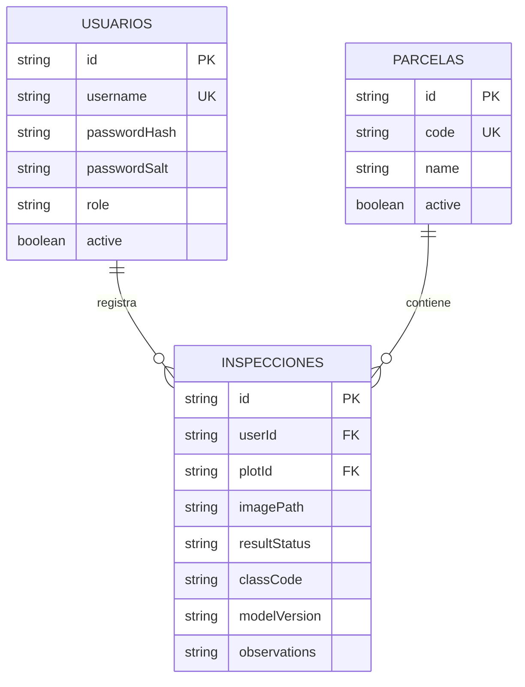

# Fundamento de arquitectura y base relacional para AgroVision Sullana

Fecha: 12 de octubre de 2026. Rama: limon-v2. Condiciones confirmadas por el usuario: conservar login; base estructurada y CRUD obligatorios; el profesor acepta SQLite local. Las decisiones descritas son propuesta técnica de implementación, no aprobación institucional ni evidencia de validación de campo.

## Dictamen

Kotlin, Compose y Room son compatibles con los requisitos académicos de una aplicación con autenticación, persistencia relacional y operaciones CRUD. La justificación es la necesidad de capturar, inferir y consultar datos sin conexión, no la novedad de las herramientas. No es necesario un servidor Spring para demostrar esas capacidades si el requisito aceptado es SQLite local.

La solución tendrá una arquitectura por capas y presentación MVVM. Las pantallas mostrarán estado y enviarán acciones; ViewModel coordinará casos de uso o repositorios; los repositorios concentrarán acceso a Room, archivos y modelo TFLite. Los casos de uso se reservan para operaciones con reglas o varios pasos. No se requiere crear una interfaz o un módulo Gradle para cada acción trivial.

## Evaluación del punto de partida

Al iniciar esta intervención la app declaraba solo InspectionEntity en AppDatabase, versión 1 y exportSchema=false. plotId era texto sin FK. Usuarios y parcelas del SQL documental no alimentaban automáticamente la base interna Android. InspectionDao incluía inserciones y consultas, pero no CRUD completos de usuarios y parcelas. El login comparaba contra una lista de credenciales en código. Por tanto la arquitectura elegida era viable, pero ese estado no bastaba para demostrar el requisito del profesor.

En el flujo anterior Dashboard, History y Result accedían directamente al DAO; Camera construía su clasificador. Había interfaces de repositorio, pero ese flujo las utilizaba de forma incompleta. No corresponde presentar el punto de partida como Clean Architecture completamente implementada. La entrada activa vuelve a MainScaffold y NavGraph con las pantallas Compose originales: login, dashboard, cámara CameraX, historial, resultado y configuración. Estas reciben una instancia compartida de LocalMvpViewModel y usan LocalMvpRepository; usuarios y parcelas añaden CRUD con el mismo estilo visual. LocalMvpScreen queda fuera de la navegación activa.

## Equivalencias para explicar la solución al profesor

| Responsabilidad | Aplicación con servidor por capas | Aplicación Android local propuesta |
|---|---|---|
| Entrada del usuario | Formulario web y controlador | Pantalla Compose y ViewModel |
| Reglas de negocio | Servicio | Caso de uso o repositorio según complejidad |
| Acceso a datos | Repositorio y ORM | Repositorio y DAO Room |
| Persistencia | Motor relacional en servidor | SQLite en almacenamiento privado del teléfono |
| Definición de estructura | Entidades, DDL y migraciones | Entidades Room, esquema SQL exportado y migraciones |
| Autenticación | Servicio de usuarios | Servicio/repositorio local ligado a tabla de usuarios |
| Inferencia | Servicio ML remoto o local | Intérprete TFLite en el teléfono |

Son equivalencias de responsabilidad, no APIs idénticas. ViewModel no es un controlador HTTP, Room no es Spring Data JPA y Compose no es un servidor. Kotlin/JVM permite interoperar con Java; el uso de Kotlin no implica abandonar los principios que se enseñan en Java [R1].

## Argumentos de selección

| Decisión | Requisito que atiende | Alternativa y límite | Evidencia de aceptación |
|---|---|---|---|
| Kotlin | Integración Android, manejo de estado y tareas asíncronas | Java también es viable; no se afirma superioridad universal | Compilación reproducible y pruebas de reglas |
| Compose y ViewModel | Formularios, navegación y actualización de listas | XML también es viable; conservar Kotlin/Compose reduce reescritura | Crear/editar/eliminar y refrescar pantalla correctamente |
| SQLite con Room | Operar sin red y mantener datos estructurados | Base de servidor requiere infraestructura y política de sincronización | CRUD en modo avión y recuperación tras reinicio |
| Repositorios | Separar UI de almacenamiento y facilitar pruebas | Acceso directo al DAO acopla pantallas a persistencia | ViewModel prueba comportamiento sin depender de una pantalla |
| TFLite local | Evaluación de imagen sin internet | Inferencia remota introduce dependencia de conectividad | Modelo real ejecutado con modo avión y contrato verificado |
| Monolito móvil por capas | Alcance pequeño y una sola persona con tiempo limitado | Microservicios y multimódulo no son necesarios para este tamaño | Entrega integrada, mantenible y trazable |

Room es una abstracción sobre SQLite con verificación de consultas SQL y soporte de migraciones [R2]. Las recomendaciones oficiales Android incluyen repositorios como entrada de la capa de datos y ViewModel para estado de presentación [R3]. Estas referencias sustentan la elección; no sustituyen pruebas de esta app.

## Modelo relacional mínimo que debe reflejar la app

El esquema físico final debe acompañar la implementación. No se tomará el archivo documental de ocho tablas como evidencia de entidades no integradas.

| Entidad | Datos principales | Restricciones |
|---|---|---|
| Usuarios | ID, nombre de acceso, nombre visible, hash y salt de contraseña, rol, activo | PK; nombre de acceso único; no almacenar contraseña en texto plano |
| Parcelas | ID, código, nombre, descripción, activo | PK; código único; validación de campos requeridos |
| Inspecciones | ID, usuario, parcela, foto, fecha, estado, código de clase, puntuación, versión del modelo, observaciones | PK; FK usuario y parcela; valores válidos de estado/puntuación; campos del resultado no editables mediante CRUD ordinario |
| Catálogo de clases | Código estable y etiqueta | Catálogo controlado por versión del modelo; no renombrar IDs para reinterpretar resultados anteriores |
| Modelos | Identificador de versión, hash, entrada/salida y fecha de disponibilidad | Datos de procedencia controlados; un texto de Ajustes no acredita modelo cargado |

Usuarios, Parcelas e Inspecciones son entidades de negocio relacionales obligatorias. Catálogo y modelos pueden comenzar como metadatos versionados e inmutables distribuidos con el asset si la implementación no necesita consultas SQL sobre ellos; en ese caso el diagrama físico debe mostrar solo tablas reales y explicar el manifiesto externo. No inflar el número de tablas para aparentar complejidad.

Este diagrama describe el núcleo propuesto. Se comprobará contra el esquema Room exportado antes de incluirlo como diseño implementado en la tesis. Una relación en un dibujo no crea una FK.

## CRUD y protección de la evidencia

| Módulo | Crear | Leer | Actualizar | Eliminar |
|---|---|---|---|---|
| Usuarios | Alta de cuentas por administrador; primer administrador mediante configuración inicial | Listado/perfil autorizado | Nombre, estado y credenciales según permisos | Eliminación si no tiene referencias; desactivación si conserva inspecciones |
| Parcelas | Código y nombre | Listado, detalle y selección para captura | Datos descriptivos | Eliminación si no tiene inspecciones; desactivación si tiene historia |
| Inspecciones | Captura, borrador durable y resultado real o error | Historial por ID, usuario y parcela | Observaciones y corrección de metadatos permitidos | Confirmación antes de eliminar registros fuera de la evaluación; datos de investigación se conservan según protocolo |

El componente de evaluación debe conservar sus resultados y versiones. Editar una anotación no modifica clase, confianza ni versión del modelo. Una nueva evaluación de imagen es una operación nueva identificada, no una edición silenciosa de la predicción previa. Las restricciones de eliminación protegen integridad; su mensaje debe explicar por qué una cuenta o parcela referenciada se desactiva.

## Login local y límites

El login se conserva como requisito obligatorio. Debe consultar usuarios persistidos y validar credenciales protegidas, no simular un servidor ni usar usuarios hardcodeados como autenticación final. El primer inicio crea una cuenta administradora de manera explícita. Una cuenta desactivada no puede iniciar sesión. Las acciones administrativas deben controlar el rol también en la capa de datos/negocio; ocultar un botón no basta.

La sesión puede persistir un identificador de usuario; se verifica que la cuenta exista y siga activa al restaurarla. Esta modalidad sirve a un piloto en un teléfono y no equivale a identidad centralizada, protección contra un dispositivo comprometido ni sesión compartida entre equipos. No se afirmará seguridad completa por el hecho de usar Room. El diseño evita guardar contraseñas legibles y restringe la exposición de datos en exportaciones.

## Migración e integridad

La migración conserva inspecciones antiguas y las identifica como LEGADO. Sus clases originales de cebolla no se reasignan a minador. Los textos de parcelas antiguas necesitan mapeo a registros legados para poder introducir FKs; las inspecciones anteriores sin usuario verificable deben asociarse a una cuenta técnica de legado desactivada, no atribuirse al usuario actual.

Exportar esquema y probar migración forma parte de la aceptación [R4]. No utilizar fallbackToDestructiveMigration para solucionar incompatibilidades ni ejecutar el generador que borra SQLite sobre datos de campo. Diferenciar archivos SQLite de escritorio y base privada Android; la evidencia debe mostrar qué archivo realmente usa la app.

Una transacción SQLite no incluye automáticamente escritura de foto. El flujo debe registrar un borrador durable y gestionar archivo incompleto, recuperación y limpieza de descartes. No afirmar cero pérdida ante todos los fallos sin pruebas de esos escenarios.

## Pruebas para defender arquitectura ante el profesor

1. Mostrar DER y DDL generado, PK/FK/índices/únicos y explicar una relación uno a muchos.
2. Crear administrador y una cuenta operaria; iniciar sesión y demostrar credencial incorrecta y cuenta desactivada.
3. Como administrador, crear, listar, editar y eliminar usuario sin referencias; demostrar restricción/desactivación cuando tiene historia.
4. Crear, editar y consultar parcela. Intentar duplicar código y eliminar una parcela con inspección.
5. En modo avión, elegir parcela, capturar imagen, ejecutar modelo real o mostrar error de disponibilidad y consultar el registro recuperado tras cerrar el proceso.
6. Crear inspecciones A y B, abrir A y comprobar que foto, metadatos y exportación pertenecen a A.
7. Actualizar desde la base anterior y verificar conteos, claves y etiquetas de legado.
8. Mostrar una prueba del repositorio/DAO y la ruta de datos pantalla → ViewModel → repositorio → Room.
9. Para ML, mostrar modelo y hash, contrato de tensores y métricas reales. CRUD correcto no demuestra exactitud agronómica.

## Ajuste al roadmap

El recorte de login queda revocado. También se reincorpora gestión local de usuarios y parcelas: no basta un código manual. RF01 y RF02 se reformulan como autenticación local y gestión relacional local; backend, GPS y cálculo fenológico siguen fuera del MVP salvo requisito adicional explícito.

El cambio consume tiempo del presupuesto ya limitado. Para absorberlo se eliminan experimentos de cuantización del camino crítico, se mantiene un único baseline MobileNetV2 y se reutilizan formularios simples. No se promete simultáneamente CRUD, nube, múltiples modelos y validación amplia dentro de las mismas horas. Medir avance por casos de aceptación, no por cantidad de pantallas.

## Texto para la sustentación

AgroVision Sullana emplea una arquitectura móvil por capas con presentación MVVM, persistencia relacional SQLite mediante Room e inferencia local TFLite. La elección responde a la necesidad de registrar y consultar inspecciones y procesar fotografías sin conexión en campo. La base mantiene usuarios, parcelas e inspecciones relacionados mediante claves y restricciones de integridad; las operaciones CRUD se ejecutan sobre esos registros persistidos. Kotlin y Compose implementan la interfaz y la coordinación del estado, mientras que los repositorios separan el acceso a datos de las pantallas. La validez de esta arquitectura se comprueba mediante pruebas de CRUD, migración, recuperación e inferencia y no por la antigüedad o novedad de las herramientas.

Utilizar este texto como descripción del producto final solo cuando esas funciones hayan superado pruebas. Mientras tanto corresponde decir “la arquitectura propuesta contempla”.

## Evidencia técnica obtenida durante la implementación

- Room generó esquema v2 con tres tablas físicas: users, plots e inspections, dos claves foráneas y seis índices explícitos, incluidos dos índices únicos. El catálogo y la versión/hash del modelo se distribuyen en manifiesto de asset; no se afirman tablas adicionales inexistentes.
- La comprobación SQLite sobre cinco inspecciones de la base anterior conservó IDs, clase original, imagen, fecha y puntuación; todos quedaron LEGADO. Columnas, índices y FKs de la migración coinciden con el esquema generado por Room. Una eliminación referenciada y un código de parcela duplicado fueron rechazados.
- Dos pruebas locales JVM de contraseña y CSV pasaron, y las pruebas instrumentadas fueron compiladas y empaquetadas. No se ejecutaron en Android porque no había teléfono/emulador conectado.
- El baseline TFLite FLOAT32 real se generó con datos externos. Su hash y contrato están en el asset; validación agronómica local, identificación temprana y tiempos en teléfono siguen pendientes.
- Las operaciones administrativas se autorizan en LocalMvpRepository. El listado de usuarios se limita a administradores activos y elimina hash/salt de los objetos que llegan a presentación. La sesión no proporciona credenciales a cuentas operarias.

El SQL de referencia reproducible se exportó a `database/agrovision_sullana_schema.sql` desde el esquema compilado `app/schemas/pe.edu.upn.agrovisionlurin.data.local.AppDatabase/2.json`. No debe sustituir la migración del teléfono ni utilizarse para borrar una instalación existente.

La evidencia anterior demuestra estructura y comprobaciones acotadas; todavía no permite declarar todo el flujo validado en dispositivo. Ver `audit/IMPLEMENTACION_LIMON_V2.md` para estado de entrega y pendientes.

## Referencias oficiales

- R1. Kotlin. [Calling Java from Kotlin](https://kotlinlang.org/docs/java-interop.html). Interoperabilidad; no demuestra por sí sola calidad del diseño.
- R2. Android Developers. [Save data in a local database using Room](https://developer.android.com/training/data-storage/room). SQLite, DAOs y consultas verificadas. Se conserva la versión de dependencias del proyecto hasta que una actualización tenga una razón técnica y pruebas.
- R3. Android Developers. [Recommendations for Android architecture](https://developer.android.com/topic/architecture/recommendations) y [Data layer](https://developer.android.com/topic/architecture/data-layer). Responsabilidades de ViewModel y repositorios.
- R4. Android Developers. [Migrate your Room database](https://developer.android.com/training/data-storage/room/migrating-db-versions). Evolución del esquema y pruebas de migración.

La revisión de fuentes y código valida pertinencia del enfoque y detecta brechas. La aprobación del docente, la ejecución de pruebas Android y la evaluación agronómica son evidencias independientes y no se presuponen en este documento.
