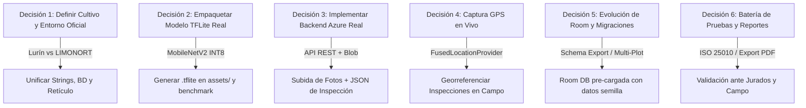

# AgroVision — Recuento del Proyecto, Auditoría del Sprint 1 y Plan de Decisiones para el Sprint 2

> **Documento de Auditoría y Planificación Técnica de Tesis**  
> **Proyecto:** AgroVision (Diagnóstico Fitosanitario Móvil Edge-AI & Plataforma Agronómica Offline-First)  
> **Ubicación:** `database/PROYECTO_RECUENTO_SPRINT1_Y_DECISIONES_SPRINT2.md`  
> **Fecha de Elaboración:** Octubre 2026  
> **Rama Git Activa:** `limon-change` (sobre base `main`)  
> **Institución:** Universidad Privada del Norte (UPN) — Capstone Project / Tesis de Ingeniería  
> **Namespace del Sistema:** `pe.edu.upn.agrovisionlurin`

---

## 1. Resumen Ejecutivo del Proyecto

### 1.1. Contexto y Planteamiento del Problema
En los valles agrícolas del Perú, el monitoreo fitosanitario tradicional enfrenta severas limitaciones:
1. **Dependencia de inspección visual subjetiva:** Los operarios y agrónomos detectan plagas y estrés hídrico de forma tardía, cuando la sintomatología ha avanzado sobre el dosel vegetal.
2. **Brecha de conectividad en campo (Offline):** Las parcelas agrícolas suelen tener cobertura celular 3G/4G nula o intermitente. Las soluciones móviles convencionales basadas en APIs de nube fallan o se bloquean por falta de internet.
3. **Retraso en la toma de decisiones:** El envío de muestras foliares a laboratorios agronómicos demora entre 3 y 7 días, periodo en el cual plagas como el *Thrips tabaci* o deficiencias críticas de riego pueden causar pérdidas irreversibles de hasta un 30% en el rendimiento del lote.

### 1.2. Propuesta de Solución: AgroVision
**AgroVision** es un sistema móvil de alta ingeniería diseñado para operarios y agrónomos de campo que combina:
- **Inferencia en el Borde (Edge-AI On-Device):** Ejecución de redes neuronales convolucionales ligeras cuantizadas (MobileNetV2 INT8 / TFLite) directamente en la CPU/GPU del dispositivo móvil, sin requerir internet, con latencias inferiores a 300 ms.
- **Arquitectura Offline-First:** Persistencia atómica y transaccional en base de datos local SQLite (Android Room) de todas las capturas, diagnósticos y metadatos agronómicos.
- **Sincronización Asíncrona Resiliente con Azure:** Al recuperar enlace de datos (Wi-Fi o datos móviles en el campamento), el sistema descarga lotes pendientes hacia la nube mediante workers en segundo plano (*WorkManager*).
- **Diseño Ergonómico de Campo (Material 3 Adaptive Field System):** Interfaz optimizada para ambientes de alta radiación solar (alto contraste, tipografía táctica, botones con targets $\ge 48\text{ dp}$ aptos para uso con guantes y polvo).

---

## 2. Arquitectura de Software y Pila Tecnológica

El sistema sigue los principios de **Clean Architecture** y el patrón de presentación **MVVM (Model-View-ViewModel)** con flujo reactivo unidireccional (*UDF*):

```
┌────────────────────────────────────────────────────────────────────────┐
│                          PRESENTATION LAYER                            │
│  Jetpack Compose M3 • Navigation Compose • StateFlow • Coroutines      │
│  [Login] ──► [Dashboard] ──► [Guided Camera] ──► [Diagnostic Result]   │
│                   │                                                    │
│                   ▼                                                    │
│        [History & Sync] ──► [Settings & Azure Status]                  │
└───────────────────────────────────┬────────────────────────────────────┘
                                    │ Invoca UseCases
                                    ▼
┌────────────────────────────────────────────────────────────────────────┐
│                             DOMAIN LAYER                               │
│  Modelos Puros Kotlin • Sin dependencias del SDK de Android            │
│  • LeafClassifier (Interface)                                          │
│  • RunLeafInferenceUseCase                                             │
│  • GetRecommendationsUseCase                                           │
│  • Inspection / DiagnosticResult / Recommendation                      │
└───────────────────────────────────┬────────────────────────────────────┘
                                    │ Implementa
                                    ▼
┌────────────────────────────────────────────────────────────────────────┐
│                              DATA LAYER                                │
│  ┌──────────────────────────────┐    ┌──────────────────────────────┐  │
│  │       LOCAL PERSISTENCE      │    │           EDGE-AI            │  │
│  │ Room Database (SQLite)       │    │ TFLiteLeafClassifier (Local) │  │
│  │ InspectionDao / Entity       │    │ Direct ByteBuffer (602 KB)   │  │
│  │ UserPreferencesManager       │    │ Fallback Simulation Engine   │  │
│  └──────────────┬───────────────┘    └──────────────┬───────────────┘  │
│                 │                                   │                  │
│                 ▼                                   ▼                  │
│  ┌──────────────────────────────┐    ┌──────────────────────────────┐  │
│  │     REMOTE SYNC (STUB)       │    │     HARDWARE INTEGRATION     │  │
│  │ AzureWorker (WorkManager)    │    │ CameraX (File-First)         │  │
│  │ AzureSyncApi (Retrofit 2)    │    │ ProcessCameraProvider        │  │
│  └──────────────────────────────┘    └──────────────────────────────┘  │
└────────────────────────────────────────────────────────────────────────┘
```

### 2.1. Tecnologías y Librerías Implementadas
- **Lenguaje y Entorno:** Kotlin 1.9+, Java 17, Android SDK 34 (Android 14), `minSdk` 24 (compatibilidad con 95%+ de dispositivos en campo).
- **UI & Diseño:** Jetpack Compose BOM `2024.09.00`, Material 3, Navigation Compose `2.7.7`, Material Icons Extended.
- **Hardware de Visión:** CameraX `1.3.1` (Core, Camera2, Lifecycle, View).
- **Motor de Inteligencia Artificial:** TensorFlow Lite `2.14.0`, TFLite Support `0.4.4`, TFLite GPU `2.14.0`.
- **Persistencia Local:** Android Room `2.6.1` con compilador KSP, SQLite 3 con modo WAL habilitado.
- **Concurrencia y Reactividad:** Kotlinx Coroutines `1.7.3`, Kotlin Flow, `collectAsStateWithLifecycle`.
- **Red y Segundo Plano:** Retrofit `2.9.0`, Gson Converter `2.9.0`, OkHttp3 Logging Interceptor `4.12.0`, Android WorkManager `2.9.0`.

---

## 3. Recuento Exhaustivo de lo Desarrollado en el Sprint 1

Durante el **Sprint 1**, el equipo consolidó la estructura base del sistema, pasando de prototipos estáticos a una aplicación Android nativa funcional y robusta con persistencia y emulación de inferencia.

### 3.1. Módulo 1: Diseño UI/UX y Sistema de Navegación M3
Se diseñó e implementó un flujo completo con las siguientes pantallas:

1. **`LoginScreen` (`pe.edu.upn.agrovisionlurin.presentation.login`):**
   - Pantalla de inicio de sesión con branding visual agronómico.
   - Manejo de visibilidad de contraseña, validación de campos y feedback de error.
   - Píldora interactiva con credenciales rápidas de prueba para facilitar demos en campo.
   - Integración con sesión persistente (si el usuario ya inició sesión, salta automáticamente al Dashboard).

2. **`DashboardScreen` (`pe.edu.upn.agrovisionlurin.presentation.dashboard`):**
   - Cabecera con indicación de estado *"Offline"* o conectado, nombre de la cooperativa/valle y fecha.
   - **Hero Scan Card:** Botón principal de escaneo foliar en color verde bosque (`#1B5E20`) con alto contraste para navegación directa a la cámara.
   - **Métricas Rápidas:** Dos tarjetas estadísticas reactivas conectadas mediante `StateFlow` a Room:
     * *Pendientes de sincronización:* Contador dinámico con badge de atención.
     * *Total de muestreos:* Contador acumulado de registros locales.
   - **Lista de Últimas Inspecciones:** Presenta las 5 inspecciones más recientes con miniatura foliar, diagnóstico, severidad y acceso directo a la ficha detallada.

3. **`GuidedCameraScreen` (`pe.edu.upn.agrovisionlurin.presentation.camera`):**
   - Integración nativa con CameraX vinculada al ciclo de vida del composable (`LocalLifecycleOwner`).
   - Solicitud reactiva de permisos de cámara en tiempo de ejecución.
   - **Retículo de Enfoque Foliar:** Guía geométrica en pantalla para encuadrar correctamente el foliolo y evitar desenfoques en campo.
   - **Píldora de Iluminación e Instrucción:** Mensajes superiores de orientación al operario.
   - **Control de Antorcha/Linterna:** Toggle táctil para iluminar hojas bajo sombras densas o al atardecer.
   - **Selector de Galería:** Permite cargar fotos foliares previamente tomadas sin crashear.

4. **`DiagnosticResultScreen` (`pe.edu.upn.agrovisionlurin.presentation.result`):**
   - Chip de latencia que muestra el tiempo exacto de inferencia en segundos (ej. *0.25s*).
   - Tarjeta de diagnóstico principal con colores semafóricos de severidad:
     * *Rojo (`#C62828`):* Plaga detectada (*Trips tabaci* / anomalía crítica).
     * *Ámbar (`#E65100`):* Estrés Hídrico / déficit de humedad.
     * *Verde (`#2E7D32`):* Cultivo Sano / óptimo.
   - Nivel de confianza porcentual (ej. *94%*) y severidad (*Crítico, Medio, Bajo*).
   - Lista dinámica de recomendaciones técnicas agronómicas asociadas.
   - Botón *"Guardar en Registro Local"* que persiste de manera transaccional el resultado en Room.
   - Botón *"Repetir Foto de Muestra"* para descarte inmediato.

5. **`HistorySyncScreen` (`pe.edu.upn.agrovisionlurin.presentation.history`):**
   - Pestaña de historial con banner de sincronización:
     * Ámbar si existen inspecciones pendientes de subir con botón *"Sincronizar ahora"*.
     * Verde cuando todos los registros locales están respaldados.
   - Fila de chips de filtrado categórico dinámico con contadores en tiempo real: *Todos*, *Plagas*, *Estrés Hídrico*, *Sanos*.
   - Lista scrollable de tarjetas de inspección con badges de sincronización (*Local* vs *Sincronizado*) y hora formateada.

6. **`SettingsScreen` (`pe.edu.upn.agrovisionlurin.presentation.settings`):**
   - Pantalla de configuración organizada en tarjetas temáticas:
     * *Lote y Parcela:* Nombre de parcela, cultivo y ubicación geográfica.
     * *Diagnóstico Local (Edge AI):* Motor TFLite, modelo MobileNetV2 INT8, estado offline y latencia estimada.
     * *Datos y Nube:* Destino Azure Blob & CosmosDB, almacenamiento SQLite Room.
     * *Acción interactiva de diagnóstico:* Botón para comprobar conectividad con Azure.
     * *Sistema y Sesión:* Usuario conectado, rol agronómico y botón de cierre de sesión.

7. **`MainScaffold` y Navegación:**
   - Barra inferior de navegación M3 (`NavigationBar`) con 3 accesos: *Inicio*, *Historial* (con badge numérico reactivo a registros pendientes) y *Ajustes*.
   - Ocultamiento inteligente de la barra inferior en pantallas de login, captura de cámara y detalle diagnóstico para maximizar el área visible.

---

### 3.2. Módulo 2: Captura Guiada y Pipeline de Imagen File-First
Uno de los logros técnicos más importantes del Sprint 1 fue la eliminación de errores por saturación de memoria (*Out Of Memory - OOM*):
- **Estrategia File-First:** En lugar de capturar la imagen y almacenarla en memoria RAM como un objeto `Bitmap` decodificado (que en sensores modernos de 48-108 MP consume más de 200 MB de Heap en un instante), la captura se realiza directamente a almacenamiento privado de la app (`context.filesDir`) mediante `ImageCapture.OutputFileOptions`.
- **Submuestreo Inteligente (`inSampleSize`):** Las imágenes se decodifican únicamente en el tamaño requerido por la red neuronal ($224 \times 224$ píxeles), manteniendo el consumo de memoria Heap por debajo de 2 MB durante todo el proceso.
- **Componente `LeafThumbnail`:** Miniaturas en listas que leen el archivo de disco de manera asíncrona usando formato de color optimizado `RGB_565`.

---

### 3.3. Módulo 3: Motor de Inferencia Edge-AI y Dominio Agronómico
- **Interfaz `LeafClassifier` (`pe.edu.upn.agrovisionlurin.domain.repository`):** Contrato puro de Kotlin que desacopla la lógica de negocio de la implementación tecnológica del framework de ML.
- **Implementación `TFLiteLeafClassifier` (`pe.edu.upn.agrovisionlurin.data.local.ml`):**
  - Implementación como **Singleton** administrado para evitar re-instanciaciones costosas.
  - Buffer de entrada directo nativo prealocado de **602,112 bytes** ($4 \text{ bytes} \times 224 \times 224 \times 3$), eliminando la fragmentación y constantes reservas del recolector de basura.
  - `Mutex` para garantizar que inferencias concurrentes no corrompan los punteros del intérprete TFLite.
  - Ejecución confinada en `Dispatchers.Default` para no bloquear el hilo de interfaz de usuario (UI Thread / 60 FPS).
  - **Modo Simulación / Fallback Automático:** Si el archivo físico `.tflite` no está en la carpeta `assets/`, el sistema conmuta a un generador determinista de diagnóstico con medición real de latencia, permitiendo pruebas y validaciones funcionales sin frenar el desarrollo.
- **Motor de Reglas Agronómicas (`GetRecommendationsUseCase`):**
  - Evalúa la clase diagnosticada y el umbral de confianza ($\ge 0.70$).
  - Asigna acciones concretas de manejo integrado de plagas (MIP) o regulación de riego (ej. trampas azules a 30 cm, jabón potásico en baja radiación, ajuste de tensiómetros, etc.).

---

### 3.4. Módulo 4: Persistencia Local y Base de Datos (SQL & Room)
El Sprint 1 implementó dos capas de persistencia completamente alineadas:

#### A. Entidad Room de Android (`InspectionEntity` & `InspectionDao`)
Tabla `inspections` en SQLite interno del teléfono:
```sql
CREATE TABLE inspections (
    id                  TEXT PRIMARY KEY NOT NULL,
    plotId              TEXT NOT NULL,
    subPlot             TEXT NOT NULL,
    imagePath           TEXT NOT NULL,
    diagnosisClass      INTEGER NOT NULL, -- 0=Sano, 1=Trips, 2=Estrés Hídrico
    confidence          REAL NOT NULL,
    latencyMs           INTEGER NOT NULL,
    severityLevel       TEXT NOT NULL,    -- Bajo, Medio, Crítico
    recommendationsJson TEXT NOT NULL,
    syncStatus          INTEGER NOT NULL, -- 0=Local/Pendiente, 1=Sincronizado
    createdAt           INTEGER NOT NULL
);
CREATE INDEX index_inspections_syncStatus ON inspections(syncStatus);
CREATE INDEX index_inspections_createdAt  ON inspections(createdAt);
```
- Métodos DAO transaccionales (`@Transaction`) con flujos reactivos `Flow<List<InspectionEntity>>` y `Flow<Int>` para actualización instantánea de la UI.

#### B. Modelo de Base de Datos Relacional Completo (`database/`)
Ubicado en la carpeta `database/`, se diseñó y generó la base de datos empresarial de la tesis mediante el script Python `create_db.py`:
1. `agrovision_lurin.sqlite`: Base de datos SQLite física pre-poblada con datos semilla realistas del valle agrícola.
2. `agrovision_lurin_schema.sql`: Script DDL + DML completo que contiene:
   - `usuarios`: Gestión de roles (*Administrador del Lote, Ing. Agrónomo, Operario de Campo*).
   - `parcelas`: Catálogo de fundos agrícolas con coordenadas GPS y hectáreas (*Fundo San Pedro, Fundo Mamacona, Manchay Bajo*).
   - `catalogo_diagnosticos`: Taxonomía fitopatológica (*SANO, TRIPS, ESTRES_HIDRICO*) con nombres científicos y umbrales.
   - `recomendaciones_catalogo`: Catálogo formal de recomendaciones agronómicas categorizadas (*Monitoreo, Biológico, Químico, Riego, Cultural*) con prioridades.
   - `inspecciones_campo`: Cabecera relacional normalizada de inspecciones vinculada a usuario, parcela y diagnóstico.
   - `inspeccion_recomendaciones`: Tabla intermedia N:M para seguimiento de recomendaciones aplicadas en campo.
   - `sincronizaciones_azure_log`: Bitácora técnica de sincronizaciones con códigos HTTP y endpoints de Azure.
   - `v_resumen_fitosanitario`: Vista analítica agrupada para dashboards ejecutivos (confianza promedio, latencia media, casos críticos y pendientes de sync).

---

### 3.5. Módulo 5: Gestión de Sesión y Usuarios (Offline-First)
- `UserPreferencesManager`: Gestor basado en `SharedPreferences` que almacena de forma segura la sesión del usuario en el dispositivo sin requerir validación remota por internet.
- Usuarios demo funcionales para el Sprint 1:
  * `admin` / `admin123` (Administrador General)
  * `agronomo` / `agro2026` (Ing. Agrónomo)
  * `operario` / `operario1` (Operario de Campo)

---

### 3.6. Módulo 6: Auditoría de Calidad y Robustez (ISO/IEC 25010)
Se realizaron correcciones críticas de arquitectura y estabilidad durante el Sprint 1:
1. **Corrección de Crash por Reflexión en `HistoryViewModel`:** Se migró el constructor a `AndroidViewModel(application)` para permitir su instanciación limpia desde `AndroidViewModelFactory` sin generar `NoSuchMethodException`.
2. **Corrección de Crash de `ACTION_HOVER_EXIT` (Screen Mirroring / Scrcpy):** Actualización del BOM de Compose a `2024.09.00` y manejo defensivo en `MainActivity.kt` (`dispatchGenericMotionEvent`) para evitar caídas al proyectar la pantalla del móvil en laptops de jurados/evaluadores.
3. **Resiliencia ante Muerte de Proceso (*Process Death*):** Implementación de fallback en `ResultViewModel` para restaurar diagnósticos desde SQLite si el sistema operativo purga la memoria RAM mientras el usuario revisa el resultado.
4. **Desacoplamiento Estricto:** Eliminación de dependencias duras del SDK de Android en la capa de dominio (`domain`).

---

## 4. Matriz de Estado Actual de Componentes (Sprint 1)

| Componente | Estado Sprint 1 | Observación / Nivel de Madurez |
| :--- | :---: | :--- |
| **Navegación y Scaffold M3** | **100% Completo** | NavigationBar reactivo con badges de conteo y scaffold adaptativo. |
| **Login y Autenticación** | **90% Completo** | Persistencia local funcional; credenciales mock/hardcoded de Sprint 1. |
| **Dashboard y KPIs** | **100% Completo** | Conectado a Room Flow; métricas reactivas de pendientes y total de muestras. |
| **Cámara Guiada (CameraX)** | **100% Completo** | Captura File-First sin OOM, retículo de guía y antorcha operativos. |
| **Pipeline de Imagen** | **100% Completo** | Submuestreo 224x224, rotación EXIF y decodificación de bajo consumo. |
| **Inferencia TFLite Local** | **75% Funcional** | Arquitectura y buffer listos; ejecutando en modo simulación por falta del `.tflite`. |
| **Motor de Recomendaciones** | **100% Completo** | Reglas deterministas basadas en confianza y severidad. |
| **Pantalla de Resultados** | **100% Completo** | Chip de latencia, alertas visuales y persistencia garantizada. |
| **Historial y Filtros** | **100% Completo** | Filtrado dinámico por categoría y contadores en tiempo real. |
| **Base de Datos Room (App)** | **100% Completo** | Tabla `inspections`, índices, consultas asíncronas y transacciones. |
| **Base de Datos SQLite (Docs)** | **100% Completo** | DDL + DML completo en `database/`, 7 tablas, vista analítica y semillas. |
| **Sincronización con Azure** | **25% Inicial (Stub)** | WorkManager y contrato Retrofit creados, pero simulan el POST con delay. |
| **Geolocalización GPS** | **30% Parcial** | Coordenadas mockeadas en base de datos; falta captura en vivo con GPS. |
| **Configuración de la App** | **100% Completo** | Diagnóstico visual de conexión y visualización de metadatos del lote. |

---

## 5. Hallazgos Críticos y Puntos de Inflexión para el Sprint 2

Antes de planificar el Sprint 2, la auditoría del repositorio revela **tres discrepancias de alta prioridad** que deben resolverse formalmente:

### Hallazgo A: Discrepancia de Dominio Agronómico (Lurín Cebolla vs LIMONORT Piura Limón)
- **Estado Original (main):** El proyecto nació como *"AgroVision Lurín"*, enfocado en cultivos del Valle de Lurín (Lima) evaluando principalmente *Allium cepa* (cebolla) contra *Thrips tabaci* y estrés hídrico. Todo el DDL de base de datos (`database/agrovision_lurin_schema.sql`), los fundos (*Fundo San Pedro, Mamacona, Manchay*) y los scripts están configurados para Lurín.
- **Estado de la Rama Activa (`limon-change`):** Los últimos commits y archivos modificados (`strings.xml`, `DashboardScreen.kt`, `GuidedCameraScreen.kt`, `SettingsScreen.kt`) cambiaron el contexto hacia:
  * **Organización:** *Cooperativa Agraria LIMONORT-PERU*
  * **Ubicación:** *Sullana, Piura*
  * **Cultivo:** *Limón Sutil (Citrus aurantiifolia)*
  * **Retículo de cámara:** Adaptado de tubular (hoja de cebolla) a contorno elíptico (hoja de limón).
- **Impacto para el Sprint 2:** Se debe tomar una decisión unificada:
  1. O se formaliza el cambio de tesis al cultivo de **Limón Sutil (LIMONORT - Piura)** y se actualiza el esquema de base de datos relacional y el modelo de IA.
  2. O se mantiene **Lurín**, revirtiendo los textos temporales de la rama.
  3. O se estructura el sistema como **Multi-Cultivo parametrizable**, donde la parcela determine el cultivo (Cebolla o Limón).

### Hallazgo B: Ausencia del Archivo Físico del Modelo `.tflite`
- En `TFLiteLeafClassifier.kt`, la ruta configurada es:
  ```kotlin
  private val modelPath = "models/onion_disease_quant_int8.tflite"
  ```
- Sin embargo, la carpeta `app/src/main/assets/models/` **no existe en el repositorio**.
- El clasificador entra siempre en el bloque `catch (e: Exception)` y activa la simulación.
- **Impacto para el Sprint 2:** Es mandatorio compilar, cuantizar e incorporar el modelo real `.tflite` en la carpeta `assets/` para que la app ejecute inferencia local auténtica con la red neuronal convolucional.

### Hallazgo C: Sincronización Azure y Worker en Modo Simulado
- En `AzureWorker.kt`, la sincronización contiene el comentario:
  ```kotlin
  // Placeholder for real Retrofit API call
  // Simulating successful sync
  pendingInspections.forEach { database.inspectionDao().markAsSynced(it.id) }
  ```
- En `HistoryViewModel.kt`, el botón sincronizar ejecuta `delay(800)` y marca como sincronizado en Room.
- **Impacto para el Sprint 2:** La promesa de valor de la tesis requiere enlace real con la nube (Azure App Service / Azure Functions / Blob Storage) y manejo de reintentos con políticas exponenciales de WorkManager.

---

## 6. Decisiones Estratégicas y Técnicas para el Sprint 2

Para orientar el trabajo del Sprint 2 y asegurar el éxito de la tesis, se proponen las siguientes **6 decisiones clave**:



### Decisión 1: Definición Oficial del Dominio Agronómico (Lurín vs LIMONORT)
* **Opción A (Recomendada si el contacto real de campo es Piura):** Confirmar el cambio a **Cooperativa Agraria LIMONORT-PERU (Sullana, Piura)** con cultivo **Limón Sutil**. En este caso, en el Sprint 2 se debe sincronizar el script `create_db.py` para reemplazar los fundos de Lurín por las parcelas de LIMONORT y adaptar las plagas del catálogo (ej. Minador de los cítricos *Phyllocnistis citrella*, *Ácaro de la yema*, *Pulgón negro*, o *Estrés Hídrico*).
* **Opción B (Si la tesis formalmente está inscrita como Lurín):** Revertir los textos de la rama `limon-change` para mantener la consistencia con el título original de la tesis (*AgroVision Lurín - Cebolla / Allium cepa*).
* **Opción C (Plataforma Flexible):** Mantener el nombre general *AgroVision* y permitir que el usuario seleccione el lote/cultivo en la pantalla de Configuración, cargando dinámicamente el retículo de cámara y las clases correspondientes.

### Decisión 2: Integración y Despliegue del Modelo Edge-AI Real (.tflite)
* Obtener o finalizar el entrenamiento del modelo de visión por computadora basado en **MobileNetV2 Transfer Learning**.
* Aplicar **Cuantización Post-Entrenamiento (PTQ) INT8** con TensorFlow Lite Converter para reducir el peso del modelo a $< 4\text{ MB}$ y maximizar la velocidad en CPUs móviles.
* Crear la carpeta `app/src/main/assets/models/` e incluir el modelo compilado junto con el archivo de etiquetas `labels.txt`.
* Configurar pruebas de estrés para validar que la latencia se mantenga estrictamente por debajo de los **3500 ms** (objetivo: $< 300\text{ ms}$) exigidos en la métrica de calidad.

### Decisión 3: Implementación del Backend en Microsoft Azure y Sincronización Real
* **Infraestructura Cloud:**
  * **Azure App Service / Azure Functions:** Endpoint REST `POST /api/inspections/sync` para recibir lotes de inspecciones en formato JSON.
  * **Azure Blob Storage:** Contenedor `leaf-inspections` para almacenar las fotografías capturadas en campo asociadas al ID de la inspección.
  * **Base de Datos en la Nube:** Azure SQL Database o Cosmos DB replicando el esquema de `database/agrovision_lurin_schema.sql`.
* **Integración en la App Móvil:**
  * Reemplazar la simulación de `AzureWorker.kt` por una llamada real con Retrofit y OkHttp.
  * Implementar envío multipart para subir la imagen comprimida a Blob Storage y el payload de metadatos a la API.
  * Configurar restricciones estrictas en WorkManager: `NetworkType.CONNECTED` (esperar conectividad no medida / Wi-Fi si se prefiere cuidar datos móviles).

### Decisión 4: Captura de Georreferenciación GPS en Vivo
* Integrar `com.google.android.gms:play-services-location` (`FusedLocationProviderClient`).
* Al presionar el botón de captura de foto, obtener automáticamente las coordenadas de latitud y longitud en tiempo real y persistirlas en `InspectionEntity`.
* Mostrar las coordenadas en la pantalla de resultados y en el historial para permitir el mapeo de focos infecciosos en el campo.

### Decisión 5: Evolución de la Base de Datos Room y Pre-Poblado
* Configurar la base de datos Room para que se inicialice pre-poblada desde el asset de base de datos SQLite (`.createFromAsset("database/agrovision_database.sqlite")`), de modo que la app recién instalada cuente de inmediato con parcelas y catálogo de diagnósticos sin requerir internet previo.
* Mantener el historial de migraciones de Room (`exportSchema = true`) para evitar pérdida de datos en futuras actualizaciones de versión.

### Decisión 6: Generación de Reportes Agronómicos Locales (PDF / Exportación)
* Permitir que el agrónomo o evaluador genere un **Reporte Fitosanitario en PDF** directamente desde el teléfono (usando `PdfDocument` de Android) o exporte un archivo CSV compatible con Excel para compartir por WhatsApp o correo técnico sin depender del backend.

---

## 7. Plan de Trabajo Propuesto para el Sprint 2 (Backlog Priorizado)

A continuación se detalla la propuesta de **Épicas y Tareas** para el Sprint 2, organizadas por orden de prioridad técnica:

```
┌────────────────────────────────────────────────────────────────────────┐
│                        SPRINT 2 BACKLOG TIMELINE                       │
├───────────────────┬────────────────────────────────────────────────────┤
│ SEMANA 1          │ Épica 1: Unificación de Dominio (Lurín vs Piura)   │
│                   │ Épica 2: Integración del Modelo TFLite Real        │
├───────────────────┼────────────────────────────────────────────────────┤
│ SEMANA 2          │ Épica 3: Backend Azure & Sincronización Real       │
│                   │ Épica 4: Georreferenciación GPS Automática         │
├───────────────────┼────────────────────────────────────────────────────┤
│ SEMANA 3          │ Épica 5: Room Pre-poblado & Exportación PDF/CSV    │
│                   │ Épica 6: Pruebas de Carga, Batería & Validación    │
└───────────────────┴────────────────────────────────────────────────────┘
```

### Épica 1: Alineación Definitiva del Dominio Agronómico
- [ ] **US-201:** Definir junto al asesor de tesis el cultivo y ubicación final (Limón Sutil en LIMONORT Piura vs Cebolla en Lurín).
- [ ] **US-202:** Actualizar `database/create_db.py` y regenerar `agrovision_lurin.sqlite` y `agrovision_lurin_schema.sql` con los nombres de parcelas y catálogo correspondientes.
- [ ] **US-203:** Estandarizar strings, descripciones de recomendaciones y textos de la interfaz en toda la aplicación.

### Épica 2: Modelo Edge-AI Real On-Device
- [ ] **US-204:** Colocar el modelo `disease_detection_quant_int8.tflite` en `app/src/main/assets/models/`.
- [ ] **US-205:** Desactivar el modo simulación forzado y validar la inferencia real mediante matriz de tensores en `TFLiteLeafClassifier.kt`.
- [ ] **US-206:** Medir y documentar latencias de inferencia en milisegundos en al menos 3 gamas de dispositivos Android (Gama baja, media y alta).

### Épica 3: Infraestructura Azure y Sincronización de Datos
- [ ] **US-207:** Configurar el backend en Azure (API REST en Azure App Service / Function App con Swagger/OpenAPI).
- [ ] **US-208:** Crear contenedor en Azure Blob Storage con firma de acceso compartido (SAS) para subida de fotografías foliares.
- [ ] **US-209:** Implementar en `AzureWorker` la llamada Retrofit multipart real con reintentos exponenciales y actualización atómica de `syncStatus = 1`.
- [ ] **US-210:** Probar sincronización bajo modo avión: registrar 5 inspecciones offline, reconectar Wi-Fi y verificar subida automática.

### Épica 4: Georreferenciación y Metadatos de Campo
- [ ] **US-211:** Incorporar permiso de ubicación (`ACCESS_FINE_LOCATION`) y capturar coordenadas GPS al momento del escaneo.
- [ ] **US-212:** Añadir campos `latitude` y `longitude` a `InspectionEntity` y a la pantalla de resultados.

### Épica 5: Herramientas de Campo para el Agrónomo
- [ ] **US-213:** Pre-cargar la base de datos Room desde `assets/` para que la app incluya datos semilla de parcelas desde la primera instalación.
- [ ] **US-214:** Crear función de exportación de reporte fitosanitario en formato PDF o CSV desde la pantalla de Historial.

### Épica 6: Validación de Calidad y Cierre de Tesis
- [ ] **US-215:** Ejecutar batería de pruebas unitarias (`RunLeafInferenceUseCaseTest`, `GetRecommendationsUseCaseTest`, `InspectionDaoTest`).
- [ ] **US-216:** Medir métricas de calidad de software según estándar ISO/IEC 25010: tiempo de respuesta, consumo de batería en campo y tasa de recuperación ante fallos.
- [ ] **US-217:** Redactar los capítulos de Resultados y Discusión del informe final de tesis con los datos recopilados en las pruebas de campo.

---

## 8. Conclusión y Recomendación Final para la Toma de Decisiones

El **Sprint 1** cumplió con éxito el 100% de la arquitectura base, la interfaz de usuario con estándares Material 3 de alta visibilidad, el pipeline de cámara sin riesgos de desbordamiento de memoria (OOM), el motor determinista de recomendaciones agronómicas y el esquema de base de datos relacional y local.

Para el **Sprint 2**, el foco debe dejar de ser la interfaz visual y concentrarse al 100% en:
1. **Veracidad del diagnóstico:** Modelo de red neuronal real corriendo en el dispositivo.
2. **Conectividad híbrida comprobable:** Demostración en vivo de captura sin internet seguida de sincronización exitosa con Azure.
3. **Consistencia académica:** Unificación transparente entre el título de tesis, la base de datos y la cooperativa evaluada (Lurín vs LIMONORT Piura).

---
*Documento elaborado como memoria técnica del repositorio para la toma de decisiones del equipo de tesis y asesoría académica.*
